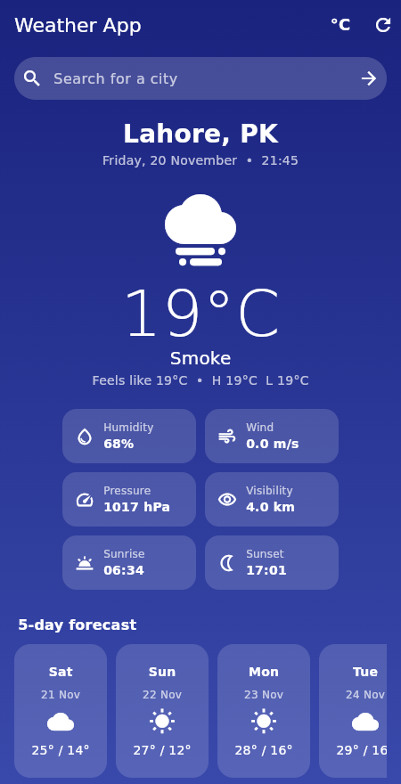
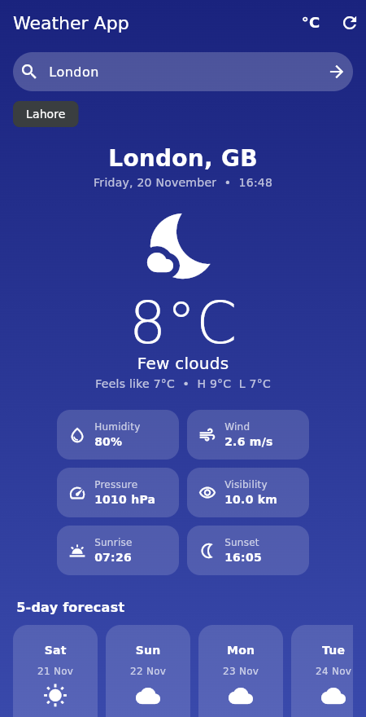
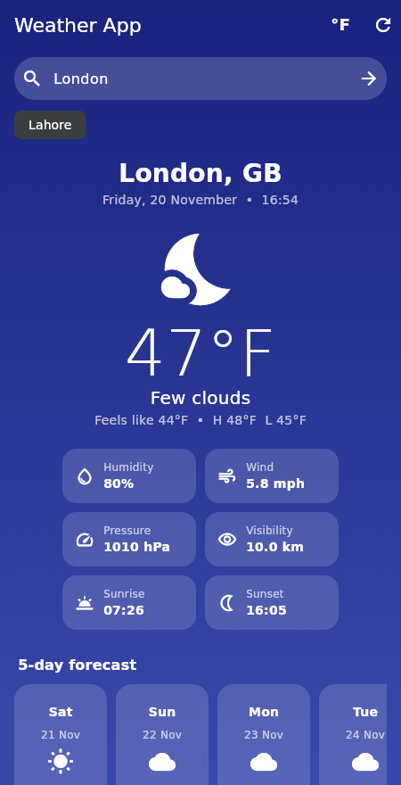
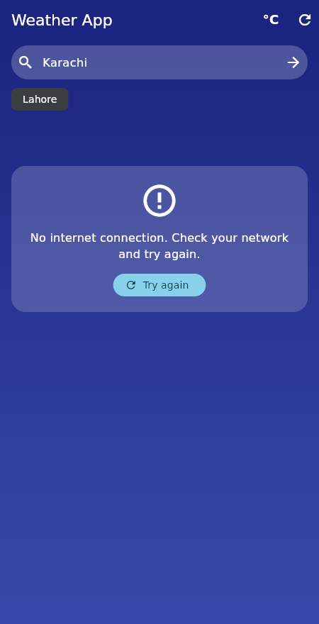

# Assignment 4 — Weather App

**CSC303 – Mobile Application Development · Assignment No. 3 (CLO-3)**

A Flutter weather app that fetches live data from the
[OpenWeatherMap](https://openweathermap.org) API. Search any city and see its
current conditions and a 5-day forecast.

## Features

- **City search** — search bar with an on-submit search and quick chips for the
  cities looked up during the session
- **Current weather** — city and country, temperature, condition with an icon,
  feels-like, daily high/low, humidity, wind, pressure, visibility, sunrise and
  sunset
- **5-day forecast** — the 3-hourly API data collapsed into one card per day
  with a high/low and the midday condition
- **Weather icons and themed background** — the icon and the background
  gradient change with the condition (clear, clouds, rain, snow, storm, fog)
  and switch to a night palette after sunset
- **°C / °F toggle** — re-queries the API in metric or imperial units
- **Pull to refresh** and a refresh button
- **Error handling** — a readable message with a *Try again* button for an
  invalid city, no internet, a timeout, a rejected API key and rate limiting

## API key

The key lives in `lib/config.dart`:

```dart
static const apiKey = String.fromEnvironment(
  'OWM_API_KEY',
  defaultValue: 'e3c92490a29585f9dd058f0a020bfad6',
);
```

It is compiled in, so the app runs straight after `flutter run`. To use a
different key without editing the code:

```bash
flutter run --dart-define=OWM_API_KEY=your_key_here
```

Endpoints used:

| Endpoint | Used for |
|---|---|
| `GET /data/2.5/weather?q={city}` | current conditions |
| `GET /data/2.5/forecast?q={city}` | 5-day / 3-hour forecast |

## Project structure

```
lib/
  main.dart                          entry point and theme
  config.dart                        API key and base URL
  models/weather.dart                current weather model
  models/forecast_day.dart           one forecast day, built from the 3-hourly list
  services/weather_service.dart      HTTP calls + error handling
  screens/home_screen.dart           search, results, error state
  widgets/current_weather_card.dart  city, temperature, icon, detail chips
  widgets/forecast_list.dart         5-day strip
  widgets/weather_visuals.dart       condition code -> icon and gradient
test/widget_test.dart                parsing and error-handling tests
screenshots/                         the running app
```

## Running it

```bash
flutter pub get
flutter run
```

Tests:

```bash
flutter test
```

## Screenshots

### 1. Current weather and 5-day forecast


### 2. Another city searched


### 3. Fahrenheit units


### 4. Invalid city handled


### 5. No internet handled

