# Lab Mid — PDF Reader & Utility Application

**CSC303 – Mobile Application Development · Lab Mid Task (100 marks)**

A Flutter PDF reader with a local SQLite database. It opens and reads PDFs,
keeps a library with bookmarks and reading history, scans pages with the
camera, converts PDF pages into images, and exports the library to CSV, PDF or
email.

## Features

**Library and document management**
- Import PDFs from device storage; the file is copied into the app folder so
  the record survives the original being moved
- Rename documents and edit their tags and description
- Mark documents as favourite, delete documents
- Search the library by name, tag or description

**Reading**
- Page navigation (previous / next), zoom in / out, scrolling
- Jump to a specific page
- Bookmark any page and jump back to it later
- Reading progress bar and percentage, saved automatically so a document
  resumes where it was left

**Utilities**
- **Document scanner** — capture pages with the camera, crop and enhance
  them (grayscale + contrast), save as a multi-page PDF
- **PDF to image** — render selected pages or the whole document to PNG/JPG
  at a chosen resolution, then share them
- **Export** — library, bookmarks and reading progress to CSV or a PDF report,
  or an emailed summary
- **Customisation** — light / dark / system theme, reading background colour,
  notification sound
- **Notifications** — a notification when a document is added and an optional
  daily reading reminder at a chosen time

## Project structure

```
lib/
  main.dart                        entry point, theme, platform setup
  app_settings.dart                preferences, persisted in SQLite
  db/database_helper.dart          schema + all queries
  models/pdf_document.dart         library item
  models/bookmark.dart             bookmarked page
  services/library_service.dart    import / store / delete PDFs
  services/scanner_service.dart    capture, enhance, build PDF
  services/pdf_image_service.dart  PDF page -> PNG/JPG
  services/export_service.dart     CSV / PDF / email export
  services/notification_service.dart  local notifications
  screens/home_screen.dart         bottom navigation shell
  screens/library_tab.dart         all PDFs + search + import
  screens/favorites_tab.dart       favourite documents + bookmarked pages
  screens/recent_tab.dart          reading history, resume
  screens/scanner_tab.dart         document scanner
  screens/reader_screen.dart       the PDF reader
  screens/convert_screen.dart      PDF to image
  screens/settings_screen.dart     theme, notifications, export
  screens/document_actions.dart    shared document actions
  widgets/document_tile.dart       list row with progress bar
test/widget_test.dart              database tests
```

## Database schema

| Table | Columns |
|-------|---------|
| `documents` | id, title, file_path, tags, description, page_count, is_favorite, source, added_on |
| `bookmarks` | id, document_id (FK cascade), page_number, label, created_on |
| `history` | document_id (PK, FK cascade), last_page, progress, opened_at |
| `settings` | key, value |

Deleting a document removes its bookmarks and history through the foreign key
cascade.

## Main packages

| Package | Used for |
|---------|----------|
| `pdfrx` | PDF rendering — the viewer and the page-to-image conversion |
| `sqflite` / `sqflite_common_ffi` | local database (FFI backend on desktop) |
| `file_picker` | importing PDFs and picking page images |
| `image_picker` | camera capture for the scanner |
| `image` | crop, grayscale and contrast for scanned pages |
| `pdf` | building PDFs from scans and the export report |
| `share_plus` / `url_launcher` | sharing files and opening the mail client |
| `flutter_local_notifications` / `timezone` | reminders |

## Running it

```bash
flutter pub get
flutter run
```

Tests:

```bash
flutter test
```

Build the APK:

```bash
flutter build apk --release
```

## Screenshots

| Library | PDF reader |
|---|---|
| 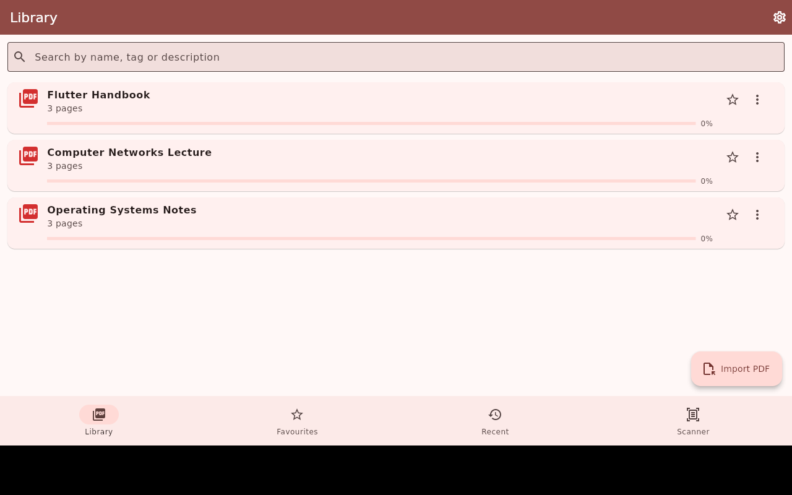 | 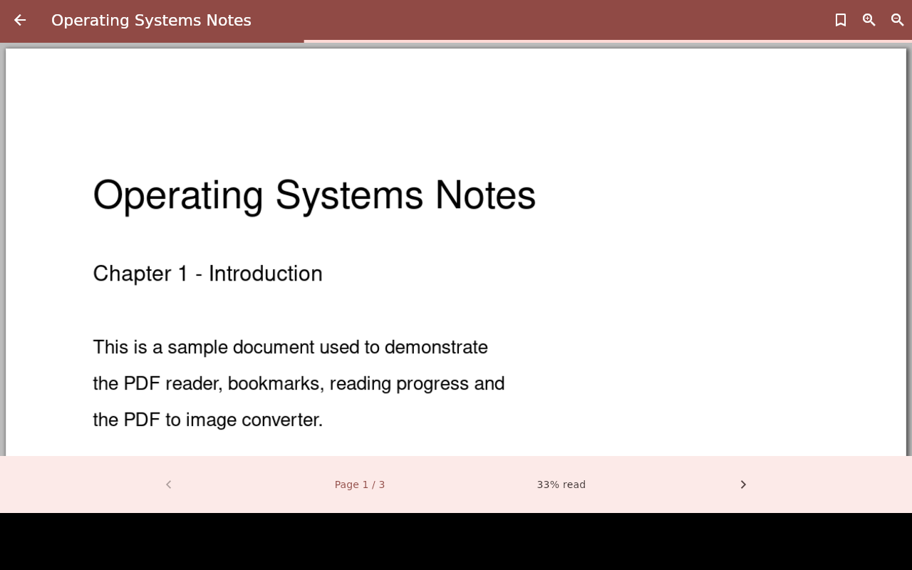 |

| Bookmark a page | Jump to page |
|---|---|
| 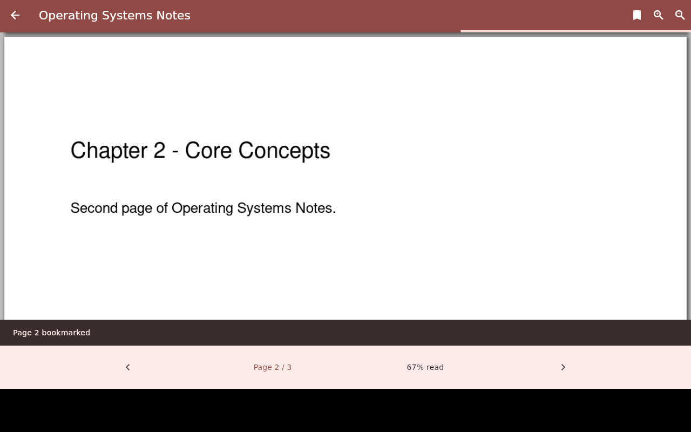 | 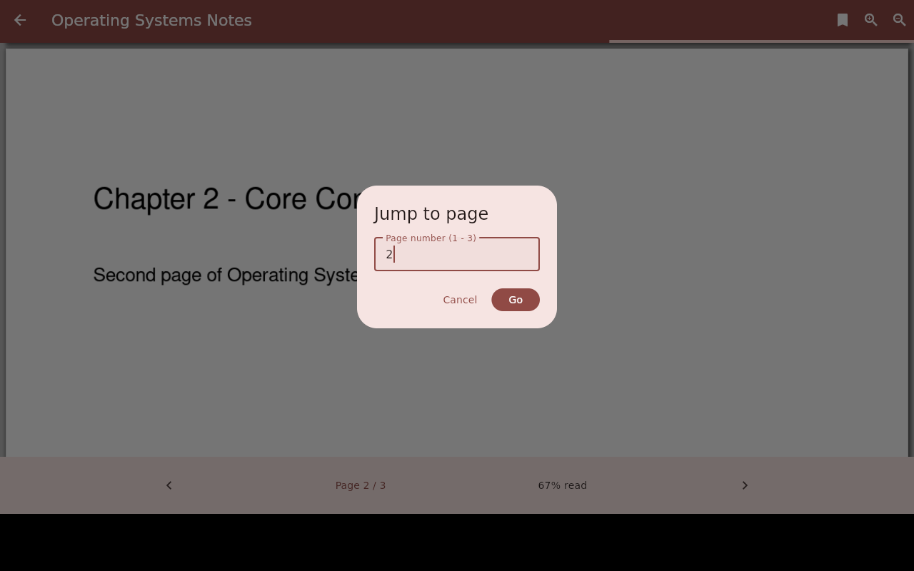 |

| Rename / edit details | Search by tag |
|---|---|
| 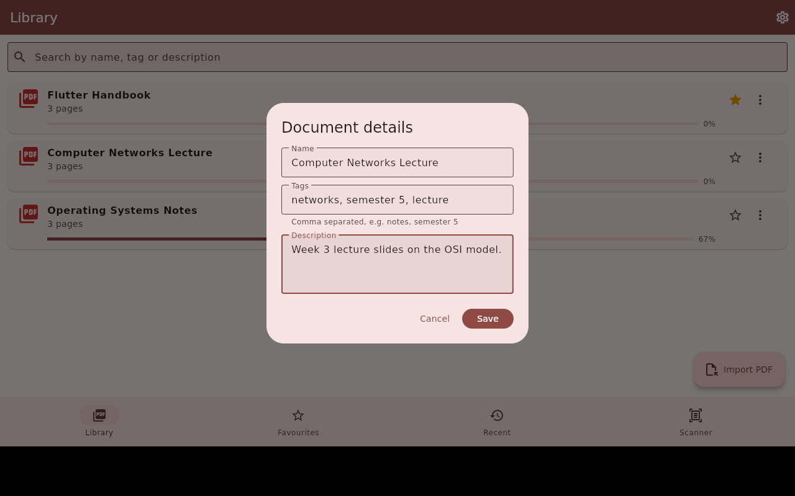 | 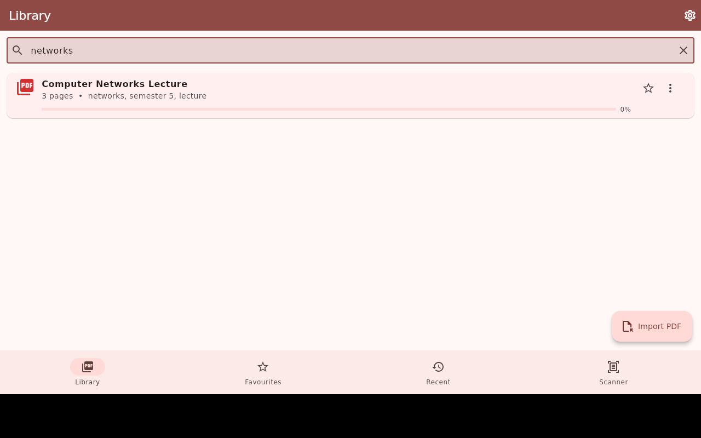 |

| Favourites and bookmarks | Reading history |
|---|---|
| 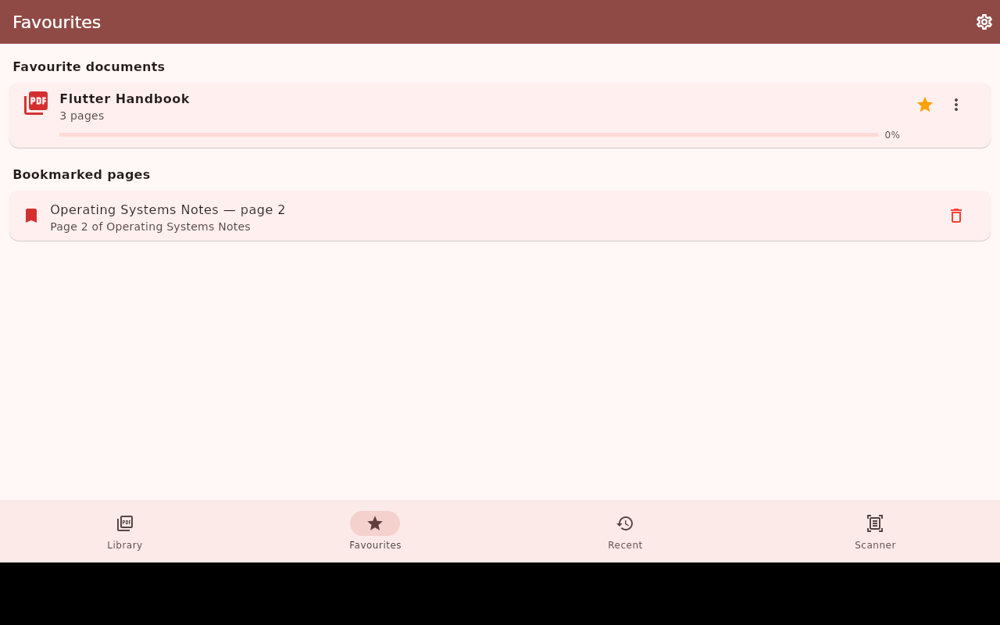 | 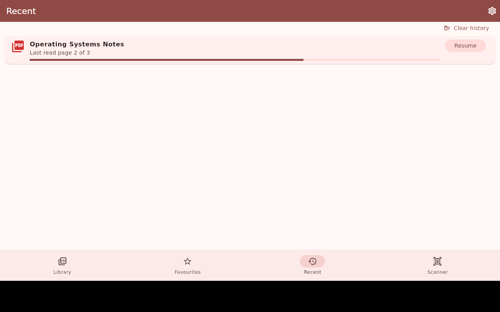 |

| Document scanner | Scan saved to library |
|---|---|
| 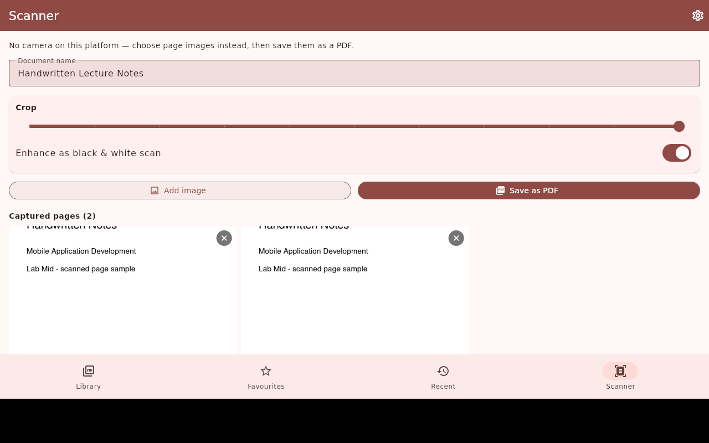 | 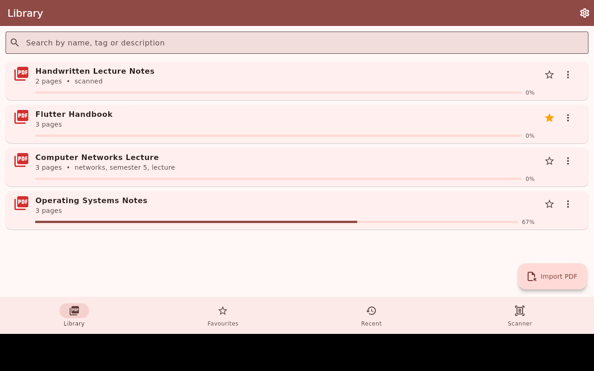 |

| PDF to image | Converted pages |
|---|---|
| 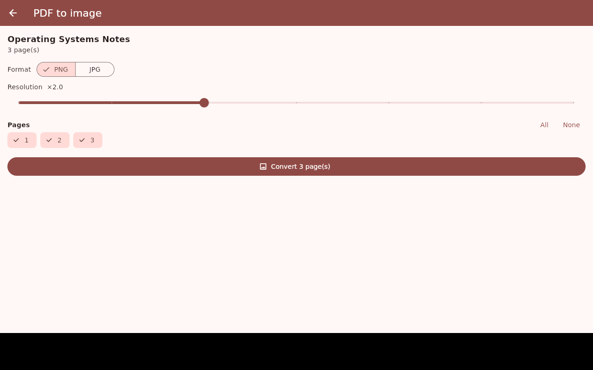 | 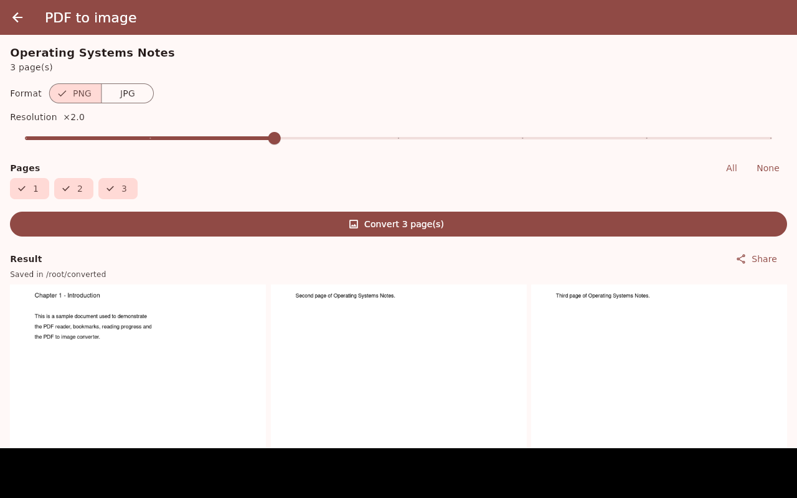 |

| Settings | Dark mode |
|---|---|
| 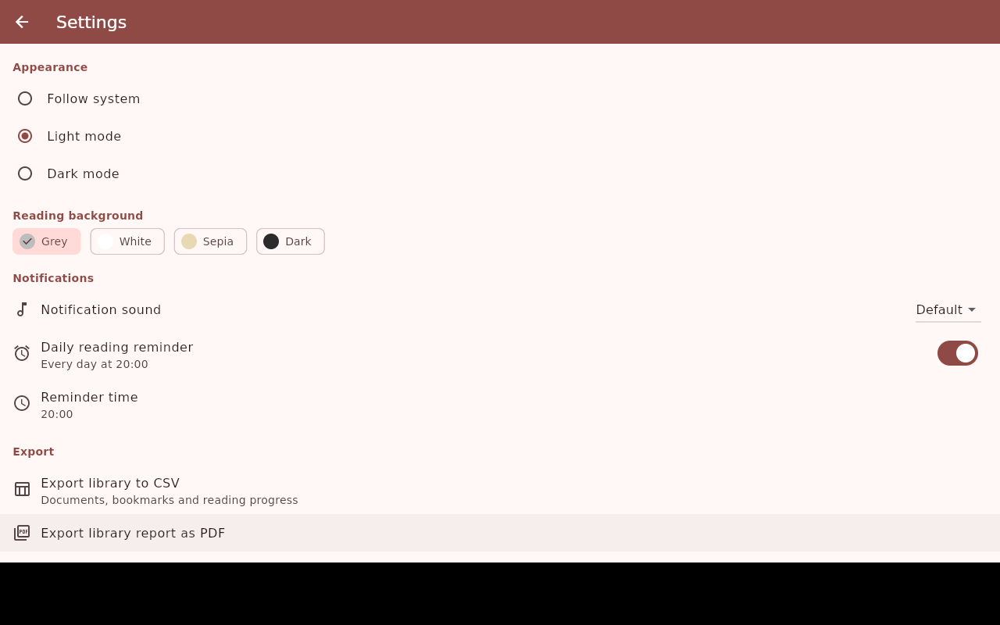 | 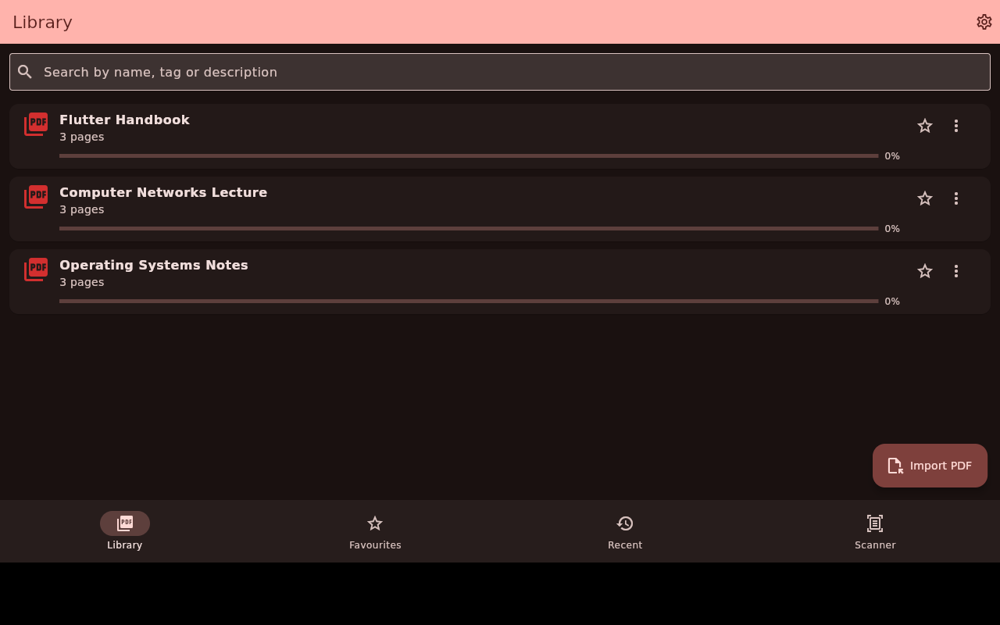 |

## Notes

- The camera scanner is Android/iOS only. On desktop the Scanner tab lets you
  pick page images instead, so the same enhance-and-build-PDF path can be used.
- `minSdk` is 23 and core library desugaring is enabled, both required by
  `flutter_local_notifications`.
