# Quiz 3 — Color Water Sort Puzzle Game

**CSC303 – Mobile Application Development · Quiz No. 3 (CLO-3)**

A complete water-sort puzzle game built with Flutter and Dart. Pour coloured
liquids between glass tubes until every tube holds a single colour. 20 levels,
animated pouring, sound, and progress saved on the device. The game is fully
offline — no network is used anywhere.

## Features

**Home screen and menus**
- Play / Continue (resumes the saved level), Level Selection, Achievements,
  How to Play, Settings and Exit (with a confirmation dialog)
- Gradient buttons, animated glass tubes under the title, fade transitions

**Gameplay**
- Transparent glass tubes drawn with `CustomPainter`: rounded base, outline,
  reflection highlight, liquid gradients, surface line and bubbles
- Tap a source tube, then a destination; tap the source again to deselect
- Selected tube lifts and scales up
- Current level, move counter and best score in the header
- Layout adapts to the tube count and the screen width

**Sorting rules** (all enforced in `GameEngine`)
- Only the topmost run of one colour can be poured, and it moves as a unit
- A pour is legal only into an empty tube, or onto the same colour
- The destination must have free space; partial pours fill what fits
- Every tube holds four units
- Invalid moves are rejected with a sound and a buzz
- A completed tube gets a glow; the puzzle ends when every tube is empty or
  a single full colour

**Pour animation**
- The source tube lifts, travels to the destination and tilts toward it
- A curved liquid stream with droplets runs from the lip into the target
- The source drains and the destination fills in step with the stream
- The tube returns to its slot afterwards
- The board is only mutated when the animation finishes, so the visuals and
  the game state can never disagree

**Levels**
- 20 levels, 3 colours up to 12, two spare tubes for temporary storage
- Puzzles are generated and then **verified with a solver** — an unsolvable
  board is discarded and regenerated, so every level is guaranteed winnable
- Generation is deterministic per level number, which is what makes "restart"
  and "best moves" meaningful
- Levels unlock in order and completed levels can be replayed

**Controls**
- **Undo** — reverses the last pour (full move history)
- **Restart** — restores the original arrangement
- **Hint** — runs the solver and highlights a move that still wins
- **Add tube** — up to two extra empty tubes as assistance
- **Pause** — resume / restart / main menu
- **Home** — back to the menu with progress saved

**Audio and haptics**
- Background music loop on the menus and during play
- Sound effects: tube select, liquid pour, button click, invalid move,
  tube completed, victory
- Vibration feedback, with separate ON/OFF switches for music, sound effects
  and vibration in Settings

**Win screen**
- "Excellent!" / "Well done!" / "Level Completed!" depending on performance
- Confetti, animated stars, move count and best score
- Next Level and Replay buttons

**Saved progress** (SharedPreferences)
- Current level, unlocked levels, stars per level, best move count per level,
  and the music / sound / vibration settings — all restored on next launch

## Project structure

```
lib/
  main.dart                       entry point, theme, Provider setup
  models/tube.dart                a tube and its liquid layers
  models/level.dart               level definition and difficulty recipes
  game/game_engine.dart           pouring rules, undo, win check, solver
  game/level_generator.dart       solvable puzzle generation, star rating
  state/game_controller.dart      one playthrough: selection, moves, win
  state/settings_controller.dart  audio and vibration preferences
  state/progress_repository.dart  SharedPreferences persistence
  services/audio_service.dart     music, sound effects, vibration
  screens/home_screen.dart        main menu
  screens/game_screen.dart        board, pour animation, controls
  screens/level_select_screen.dart level grid with locks and stars
  screens/win_screen.dart         level-complete celebration
  screens/settings_screen.dart    audio, vibration, reset progress
  screens/how_to_play_screen.dart instructions and sorting rules
  screens/achievements_screen.dart progress, badges, level results
  widgets/tube_widget.dart        glass tube CustomPainter
  widgets/pour_stream.dart        falling liquid CustomPainter
  widgets/confetti.dart           celebration particles
  widgets/liquid_palette.dart     the 12 liquid colours
  widgets/game_background.dart    shared background, buttons, star row
assets/audio/                     music and sound effects
test/widget_test.dart             rules, solver and level generation tests
```

## Technical notes

| Requirement | Choice |
|---|---|
| Framework / language | Flutter, Dart |
| Platform | Android |
| State management | Provider (`ChangeNotifier`) |
| Local storage | SharedPreferences |
| Audio | `audioplayers` |
| Vibration | `vibration` |
| Graphics / animation | `CustomPainter`, `AnimationController`, `TweenAnimationBuilder` |

The solver is a depth-first search over canonical board signatures (tube order
is ignored), with move ordering that prefers finishing or emptying a tube. It
powers three things: level validation, the Hint button, and the par used for
the star rating.

## Running it

```bash
flutter pub get
flutter run
```

Tests — the sorting rules, undo, the solver, and a check that all 20 levels
are solvable and correctly built:

```bash
flutter test
```

Build the APK:

```bash
flutter build apk --release
```

## Screenshots

| Home screen | Gameplay |
|---|---|
| 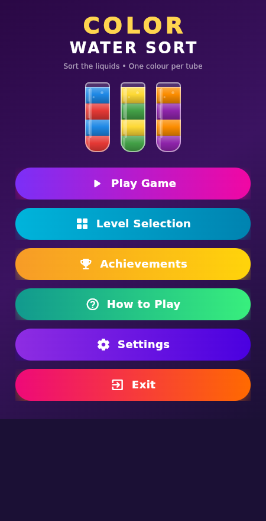 | 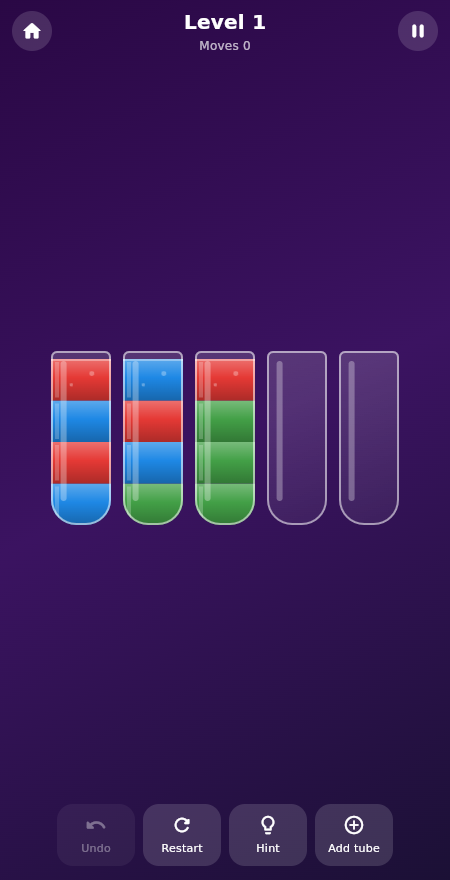 |

| Tube selected and lifted | Pouring animation |
|---|---|
| 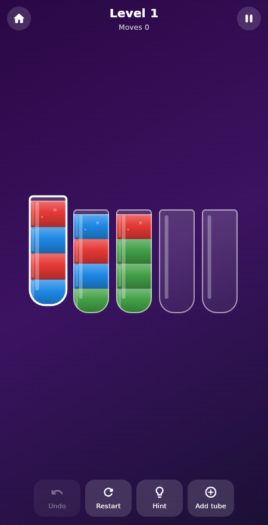 | 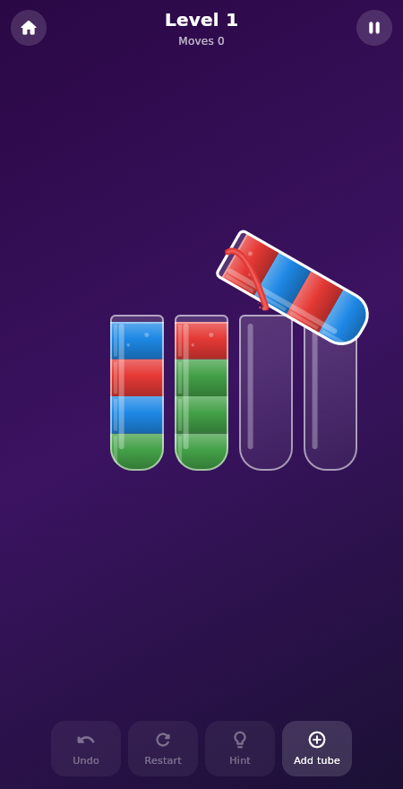 |

| Hint highlighting a move | Pause menu |
|---|---|
| 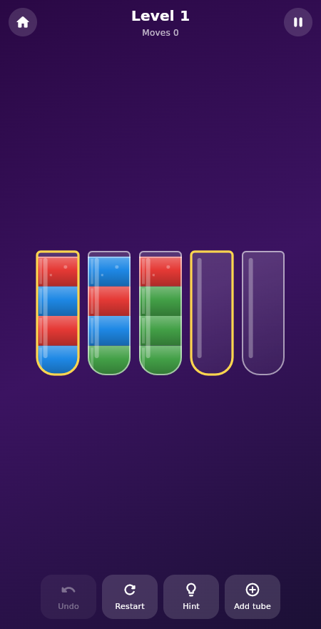 | 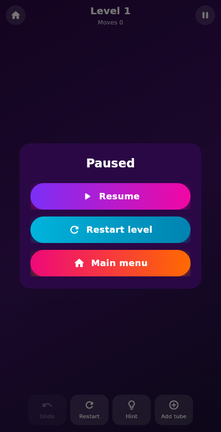 |

| Level complete | Level selection |
|---|---|
| 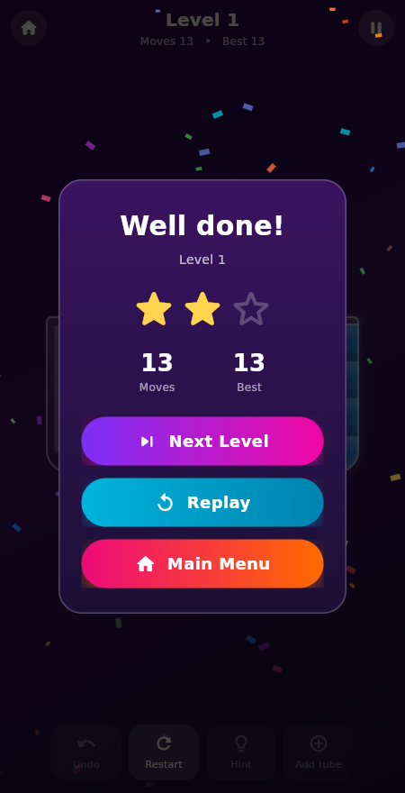 | 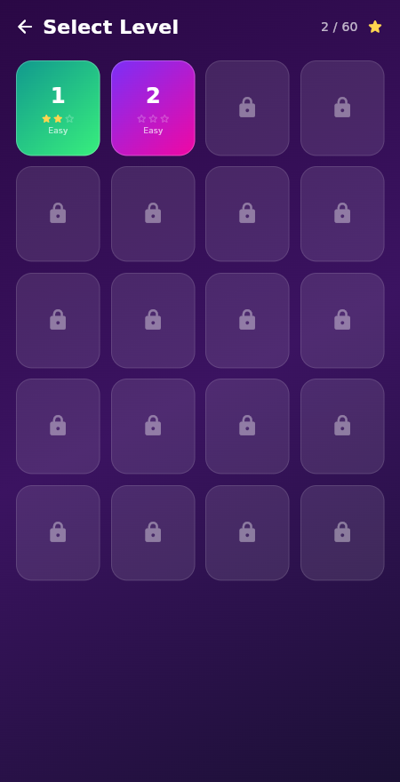 |

| Achievements | How to play |
|---|---|
| 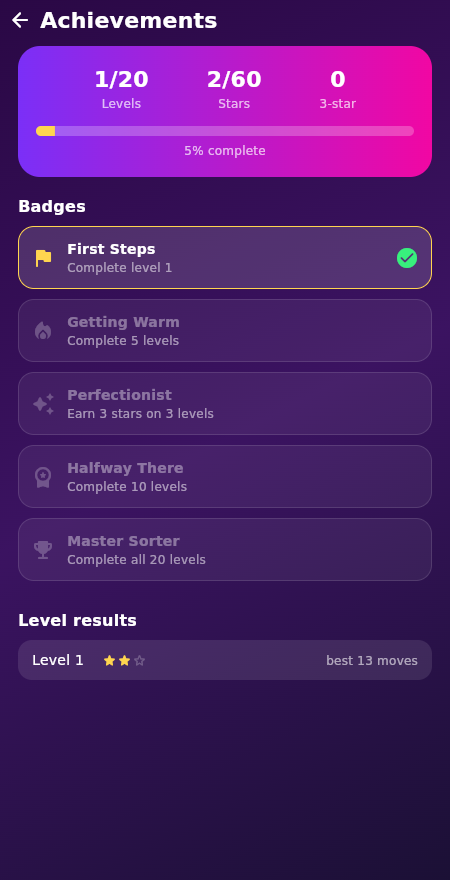 | 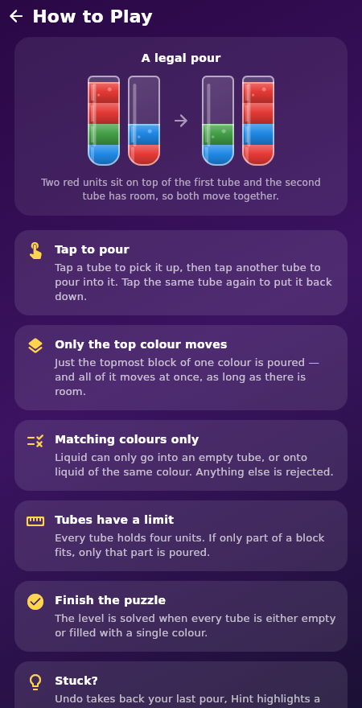 |

| Settings |
|---|
| 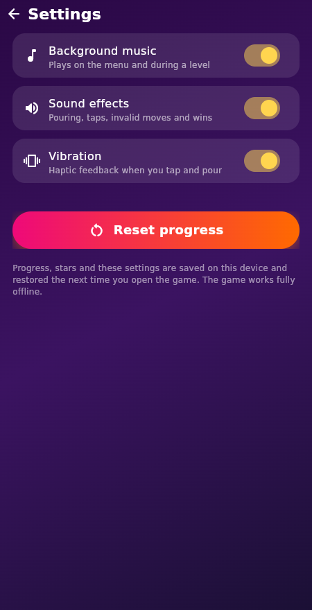 |
